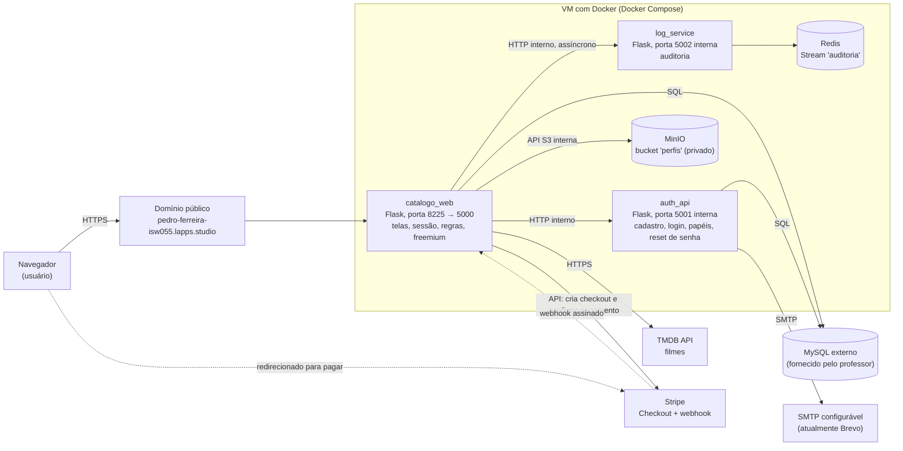
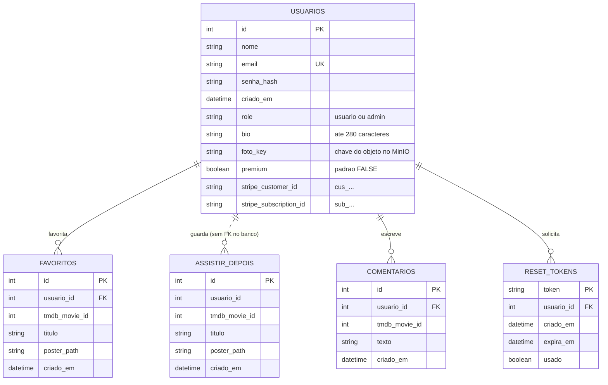

# 📚 Documentação Reversa do Sistema — Catálogo de Filmes

**Disciplina:** Computação em Nuvem — **Professor:** [@siriani](https://github.com/siriani)
**Ambiente de produção:** https://pedro-ferreira-isw055.lapps.studio
**Fechamento da série:** 16/10/2026 — agenda → catálogo → login → RBAC → logs → perfil → premium

> Voltar ao [README principal](./README.md).

## 🎯 Contexto e visão geral

Este documento registra, **depois do código escrito**, como o sistema Catálogo de Filmes funciona. O projeto cresceu aos poucos, de um catálogo web simples para uma arquitetura de microsserviços em containers Docker, com controle de acesso por papéis (RBAC), auditoria em Redis, armazenamento de fotos em object storage privado e um plano pago (freemium) cobrado pelo Stripe em modo de teste.

Foi escrito como se o código tivesse sido herdado de outra pessoa: tudo aqui foi extraído de `catalogo_service/app.py`, `auth_service/app.py`, `log_service/app.py`, `docker-compose.yml`, dos templates e do modelo de dados visto no banco, e não da memória.

## Sumário

1. [Especificação funcional](#1--especificação-funcional-ponto-de-vista-do-usuário)
2. [Arquitetura](#2-️-arquitetura-do-sistema-big-picture)
3. [Camadas de nuvem (SaaS, PaaS, IaaS)](#3-️-mapeamento-de-camadas-de-nuvem-saas-paas-iaas)
4. [Regras de negócio](#4-️-regras-de-negócio-do-código-se-x-então-y)
5. [Modelo de dados](#5-️-modelo-de-dados-e-armazenamento)
6. [Manutenção e dívidas técnicas](#6-️-manutenção-e-dívidas-técnicas)

---

## 1. 📖 Especificação funcional (ponto de vista do usuário)

O sistema é uma plataforma web para explorar a filmografia de Tom Hanks (dados do TMDB), montar listas pessoais de filmes, comentar e, opcionalmente, assinar um plano Premium.

### Perfis de uso

| Perfil | Como se torna | O que pode |
|---|---|---|
| Visitante | — | Ver cadastro, login e recuperação de senha. |
| Usuário gratuito | Cadastro | Catálogo, até 3 favoritos, até 3 em "Assistir depois", comentários, perfil. |
| Usuário Premium | Pagamento da assinatura | Tudo do gratuito, com as duas listas sem limite. |
| Admin | Campo `role = 'admin'` no banco | Tudo do usuário, mais gestão de usuários, métricas, logs e moderação de comentários. |

### 1.1 Autenticação e identidade

- **Cadastro** (`/register`): nome, e-mail e senha. Campos obrigatórios, e-mail único e senha guardada apenas como hash. Toda conta nasce com papel `usuario` e plano gratuito (`premium = FALSE`).
- **Login** (`/login`): e-mail e senha. Se corretos, abre uma sessão assinada (cookie) com id, nome e papel do usuário. Se errados, mostra uma mensagem de erro.
- **Logout** (`/logout`): encerra a sessão e registra o evento no log.
- **Recuperação de senha** (`/forgot-password` e `/reset-password`):
  - o usuário informa o e-mail e o sistema sempre responde com a mesma mensagem neutra ("Se o e-mail existir, um link de recuperação será enviado");
  - se a conta existe, é gerado um token de 32 bytes (64 caracteres hexadecimais) válido por 30 minutos e enviado por e-mail via SMTP. O Mailtrap foi usado somente durante os testes; depois, o ambiente foi configurado com o Brevo para enviar e-mails reais e permitir a redefinição de senha pela caixa de entrada do usuário;
  - na página de redefinição, se o token for válido, não usado e não expirado, o usuário define a nova senha e o token deixa de valer.

### 1.2 Catálogo de filmes

- **Metadados do TMDB:** ao abrir `/`, o sistema consulta a API do TMDB para obter a filmografia de Tom Hanks.
- **Destaque:** o primeiro filme que tem pôster aparece em destaque no topo, com imagem de fundo, título, sinopse e atalhos de **Favoritar** e **Assistir depois**.
- **Grade de títulos:** os filmes com pôster aparecem numa grade de cartões. Ao clicar num título abre um painel com sinopse, botões de ação e os comentários.

### 1.3 Listas pessoais: favoritos e "Assistir depois"

- **Favoritos** (`/favoritar`, `/desfavoritar`): marcar e desmarcar com um clique. Filmes favoritados recebem uma estrela (★) no pôster e aparecem no perfil.
- **Assistir depois** (`/assistir-depois`): fila independente dos favoritos, com página própria no menu, onde o usuário vê os pôsteres e remove itens. Também dá para adicionar e remover pelo catálogo.

### 1.4 Modelo freemium

| | Gratuito | Premium |
|---|---|---|
| Favoritos | até 3 | ilimitado |
| Assistir depois | até 3 | ilimitado |
| Selo no perfil | — | ⭐ Premium |

Ao tentar passar de 3 itens em qualquer lista, o usuário gratuito é levado ao perfil com um aviso para assinar o Premium.

### 1.5 Plano Premium e checkout Stripe

- **Assinatura** (`/premium/assinar`): no perfil, o usuário gratuito contrata o plano por R$ 9,90/mês. O sistema cria uma Checkout Session do Stripe em modo assinatura e redireciona o usuário para a página de pagamento **hospedada pelo Stripe**. O sistema nunca vê o número do cartão. No ambiente de teste vale o cartão `4242 4242 4242 4242`.
- **Confirmação e ativação**, por dois caminhos independentes (o que chegar primeiro ativa o Premium):
  - **Webhook** (`/webhook/stripe`): o Stripe chama o sistema, que valida a assinatura (`Stripe-Signature`). Em `checkout.session.completed` ativa o Premium; em `customer.subscription.deleted` volta o usuário ao plano gratuito.
  - **Verificação direta na volta do checkout** (`/premium/sucesso`): o Stripe devolve o usuário com o id da sessão; o sistema consulta a API do Stripe, confere o pagamento e ativa o Premium sem esperar o webhook.
- **Atualização manual** (`/premium/sincronizar`): botão "Já paguei, atualizar status" no perfil, para quem pagou mas ainda aparece como gratuito.

### 1.6 Perfil e foto (object storage privado)

- **Perfil** (`/perfil`): nome, e-mail, bio, plano atual (com os contadores de uso do plano gratuito) e os filmes favoritados. O selo Premium aparece no perfil.
- **Bio** (`/perfil/bio`): texto curto, cortado em 280 caracteres.
- **Foto** (`/perfil/foto` e `/foto/<id>`): aceita PNG, JPG, JPEG, GIF e WebP de até 5 MB. O arquivo vai para um bucket privado do MinIO; o banco guarda só a chave do objeto. A imagem chega ao navegador pela rota `/foto/<id>` do próprio sistema, que busca no MinIO por dentro da rede Docker, sem expor o MinIO à internet.

### 1.7 Comentários e moderação

- **Comentar** (`/comentar`): qualquer usuário logado comenta em qualquer filme; o comentário mostra o autor.
- **Apagar** (`/deletar-comentario/<id>`): o autor apaga o próprio comentário; o admin apaga o de qualquer pessoa. O log registra se foi `(próprio)` ou `(moderação)`.

### 1.8 Painel administrativo (somente `admin`)

- **Usuários** (`/admin/usuarios`): lista as contas, altera o papel (`usuario` ou `admin`) e apaga usuários. O admin não consegue apagar a própria conta.
- **Métricas** (`/admin/metricas`): total de usuários, de favoritos, de filmes distintos favoritados, de comentários e usuários por papel.
- **Logs** (`/admin/logs`): últimos eventos de auditoria, do mais recente ao mais antigo, com horário de Brasília (UTC-3). O parâmetro `?n=` define quantos eventos mostrar (padrão 50).

---

## 2. 🏛️ Arquitetura do sistema (big picture)

O sistema é dividido em microsserviços em containers Docker. Só o `catalogo_web` é acessível pela internet; os outros serviços se comunicam pela rede interna do Docker e com serviços externos.

### 2.1 Diagrama geral



### 2.2 Papel de cada componente

| Componente | Tecnologia | Porta | Acesso | Responsabilidade |
|---|---|---|---|---|
| `catalogo_web` (`catalogo_service`) | Python / Flask | 8225 (mapeada para 5000) | Público | Interface web, sessões, controle de acesso por papel, limites do plano gratuito, chamadas aos serviços internos, proxy das fotos do MinIO, integração com o Stripe (checkout, webhook e verificação). |
| `auth_api` (`auth_service`) | Python / Flask | nenhuma publicada (5001 interna) | Só rede Docker | Identidade: cadastro, login com hash, tokens de redefinição de senha, envio de e-mail e endpoints administrativos de usuário. |
| `log_service` | Python / Flask | nenhuma publicada (5002 interna) | Só rede Docker | Recebe eventos de auditoria (`POST /eventos`) e lista os recentes (`GET /eventos`). |
| `redis` | Redis 7 Alpine | nenhuma publicada (6379 interna) | Só rede Docker | Guarda o log num Redis Stream (`XADD` e `XREVRANGE`), com volume `redis_data`. |
| `minio` | MinIO (compatível com S3) | nenhuma publicada (9000 interna) | Só rede Docker | Guarda as fotos de perfil, com volume `minio_data`. |
| MySQL | MySQL externo | — | Externo | Banco relacional compartilhado por `catalogo_service` e `auth_service`. Fornecido pelo professor, com usuário e senha por aluno. |
| Stripe | SaaS | HTTPS | Externo | Hospeda o checkout, guarda os dados de cartão e envia o webhook. |
| Brevo (SMTP) | SaaS | SMTP (configurado por variáveis de ambiente) | Externo | Provedor atual para envio de e-mails reais de recuperação de senha; o Mailtrap foi usado somente para testes. |
| TMDB | SaaS | HTTPS | Externo | Fornece os dados dos filmes. |

### 2.3 Fluxos principais

- **Login:** navegador → `catalogo_web` → `auth_api` confere o hash → `catalogo_web` guarda `user_id`, `nome` e `user_role` na sessão.
- **Foto:** `catalogo_web` valida o arquivo e grava no MinIO com a chave `{user_id}/{uuid}.{ext}`; o MySQL guarda só a chave. Para exibir, `/foto/<id>` busca no MinIO e entrega os bytes.
- **Auditoria:** a cada ação relevante, `catalogo_web` envia o evento ao `log_service` numa thread separada, com timeout de 2 s e falhas ignoradas.
- **Assinatura Premium:**
  1. `POST /premium/assinar` cria a Checkout Session (com o id do usuário em `client_reference_id`) e redireciona para o Stripe.
  2. O cartão é digitado só no Stripe.
  3. A ativação acontece por dois caminhos independentes: o webhook assinado do Stripe e a verificação direta feita em `/premium/sucesso` na volta do checkout; o que chegar primeiro vale.
  4. O banco guarda só `stripe_customer_id` e `stripe_subscription_id`.

---

## 3. ☁️ Mapeamento de camadas de nuvem (SaaS, PaaS, IaaS)

O sistema usa as três camadas ao mesmo tempo:

```
┌────────────────────────────────────────────────────────────────────────┐
│ SaaS — eu só consumo um produto pronto                                  │
│ Stripe, provedor SMTP (atualmente Brevo), TMDB                          │
├────────────────────────────────────────────────────────────────────────┤
│ PaaS — o provedor cuida do SO e do runtime, eu entrego código/imagem    │
│ Containers Docker (catalogo, auth, log, redis, minio) e o MySQL         │
│ fornecido pelo professor                                                │
├────────────────────────────────────────────────────────────────────────┤
│ IaaS — o provedor entrega a máquina, eu instalo SO e Docker             │
│ VM Proxmox da Fatec (Ubuntu + Docker)                                   │
└────────────────────────────────────────────────────────────────────────┘
```

### Análise por componente

**IaaS — VM da Fatec (Ubuntu + Docker).**
- *Do provedor:* o hardware virtualizado, com CPU, memória, disco e rede.
- *Minha:* o sistema operacional da VM, a instalação do Docker e do Docker Compose e a manutenção dessa base.

**PaaS — containers da aplicação.**
- *Da plataforma:* o Docker isola cada serviço, resolve nomes na rede interna e monta os volumes.
- *Minha:* os `Dockerfile`, as dependências (`requirements.txt`), as variáveis de ambiente (`.env`), o código Flask e os templates. Como eu mesmo administro o Docker na VM, é um PaaS "caseiro", menos gerenciado que um PaaS de nuvem pública.

**PaaS — MySQL externo (banco como serviço).**
- *Do provedor (professor):* servidor, sistema operacional, instalação, manutenção e rede do banco.
- *Minha:* só o que fica dentro do banco, ou seja, tabelas, colunas e dados. Acesso por usuário e senha entregues pelo professor, tanto pelo DBeaver quanto pelo pool de conexões da aplicação.

**SaaS — Stripe, Brevo (SMTP) e TMDB.**
- *Stripe:* consumido por API, página de checkout hospedada e webhook. O Stripe responde pela segurança dos dados de cartão e pela comunicação com os bancos.
- *Brevo:* o ambiente atual usa o serviço SMTP autenticado do Brevo para enviar e-mails reais de recuperação de senha. Durante os testes foi usado o Mailtrap, que não era destinado à entrega de mensagens reais. O código recebe as configurações por variáveis `MAIL_*` e pode ser adaptado para outro provedor SMTP sem mudanças na lógica de envio.
- *TMDB:* consumido por API pública com chave. Fornece títulos, sinopses e pôsteres mantidos por terceiros.

---

## 4. ⚖️ Regras de negócio do código ("Se X, então Y")

Extraídas da leitura de `catalogo_service/app.py`, `auth_service/app.py` e `log_service/app.py`.

### 4.1 Identidade e autenticação

- **RN-01:** Se o cadastro vier sem nome, e-mail ou senha (`POST /register`), então o `auth_api` recusa com HTTP 400 ("Dados incompletos").
- **RN-02:** Se o e-mail do cadastro já existe, então a inserção é recusada com HTTP 409 ("Email já cadastrado").
- **RN-03:** Se o cadastro é aceito, então a senha é guardada como hash com salt (Werkzeug) e o papel é fixado em `'usuario'`.
- **RN-04:** Se o login tem e-mail inexistente ou senha que não confere com o hash, então responde HTTP 401 com a mesma mensagem ("Credenciais inválidas").
- **RN-05:** Se o login é aprovado, então o `catalogo_web` grava `user_id`, `nome` e `user_role` na sessão (cookie assinado) e registra o evento `login`.
- **RN-06:** Se o usuário pede logout, então o evento `logout` é registrado e a sessão é limpa.
- **RN-07:** Se o usuário não está logado, então as telas protegidas redirecionam para `/login`; as rotas `/admin/*` e `/foto/<id>` respondem HTTP 401 em vez de redirecionar.

### 4.2 Recuperação de senha

- **RN-08:** Se alguém pede o link de recuperação (`POST /forgot-password`), então a resposta é sempre HTTP 200 com a mesma mensagem neutra, existindo ou não o e-mail.
- **RN-09:** Se o e-mail existe, então é criado em `reset_tokens` um token de 32 bytes (`secrets.token_hex(32)`) que expira em 30 minutos, com `usado = FALSE`.
- **RN-10:** Se o envio do e-mail falha, então a solicitação responde HTTP 500.
- **RN-11:** Se a redefinição usa token inexistente, já usado ou expirado, então é recusada com HTTP 400 ("Link inválido ou expirado").
- **RN-12:** Se a redefinição é aceita, então a senha do usuário é trocada pelo novo hash e o token é marcado como `usado = TRUE`, e não pode mais ser reutilizado.

### 4.3 Controle de acesso por papel e administração

- **RN-13:** Se uma rota `/admin/*` é acessada sem sessão, então o `@admin_required` responde HTTP 401 ("Não autenticado").
- **RN-14:** Se um usuário com papel diferente de `admin` acessa uma rota `/admin/*`, então responde HTTP 403 ("Ação restrita a administradores.") e registra o evento `acesso_negado` com o caminho acessado.
- **RN-15:** Se o novo papel enviado não é exatamente `'usuario'` ou `'admin'`, então o `auth_api` recusa com HTTP 400 ("role inválido").
- **RN-16:** Se o admin tenta apagar a própria conta, então a ação é recusada.
- **RN-17:** Se um usuário é apagado, então o `auth_api` apaga antes seus favoritos, comentários e tokens de reset e só depois o registro em `usuarios`. (A tabela `assistir_depois` não entra nessa limpeza; ver [seção 6](#6-️-manutenção-e-dívidas-técnicas).)

### 4.4 Comentários

- **RN-18:** Se um usuário logado comenta (`POST /comentar`), então o texto é gravado com o `user_id` da sessão e o id do filme no TMDB, e o evento `comentar` guarda os 100 primeiros caracteres.
- **RN-19:** Se a exclusão de um comentário é pedida (`POST /deletar-comentario/<id>`):
  - e o requisitante é o autor, então a exclusão é permitida e registrada como `(próprio)`;
  - e o requisitante não é o autor mas é `admin`, então é permitida e registrada como `(moderação)`;
  - e não é nem autor nem admin, então responde HTTP 403 e registra `acesso_negado`;
  - e o comentário não existe, então responde HTTP 404.

### 4.5 Favoritos e "Assistir depois"

- **RN-20:** Se o usuário não é Premium e já tem 3 favoritos (`LIMITE_GRATIS = 3`), então um novo favorito é bloqueado, o evento `limite_atingido` (detalhe `favoritos`) é registrado e o usuário é levado ao perfil com um aviso.
- **RN-21:** Se o usuário não é Premium e já tem 3 filmes em "Assistir depois", então a nova inclusão é bloqueada, o evento `limite_atingido` (detalhe `assistir_depois`) é registrado e o usuário é levado ao perfil.
- **RN-22:** Se o usuário é Premium, então a checagem de limite retorna "não atingido" e as duas listas não têm limite.
- **RN-23:** Se o mesmo filme é adicionado duas vezes pelo mesmo usuário, então a duplicata é ignorada (restrição de unicidade por usuário e filme em `favoritos` e `assistir_depois`).
- **RN-24:** Se um usuário remove um item de qualquer lista, então a consulta filtra por `usuario_id = session['user_id']`, e ninguém remove itens de outra conta.
- **RN-25:** Se um usuário volta ao plano gratuito (assinatura cancelada) com mais de 3 itens, então mantém o que salvou, mas não consegue adicionar novos itens enquanto estiver no limite ou acima dele.

### 4.6 Perfil e foto

- **RN-26:** Se o usuário salva a bio (`POST /perfil/bio`), então o texto é cortado em 280 caracteres e gravado só para `session['user_id']`.
- **RN-27:** Se é enviada uma foto (`POST /perfil/foto`):
  - e a extensão não é `png`, `jpg`, `jpeg`, `gif` ou `webp`, então é recusada com aviso;
  - e o tipo do conteúdo não começa com `image/`, então é recusada;
  - e o upload passa de 5 MB (`MAX_CONTENT_LENGTH`), então o servidor recusa o envio (HTTP 413);
  - e é aceita, então vai para o bucket `perfis` do MinIO com a chave `<user_id>/<uuid>.<ext>` e a chave é gravada em `usuarios.foto_key`.
- **RN-28:** Se uma foto é pedida em `GET /foto/<id>`:
  - sem sessão, responde HTTP 401;
  - se o usuário não tem `foto_key` ou o objeto não existe no MinIO, responde HTTP 404;
  - caso contrário, entrega os bytes com `X-Content-Type-Options: nosniff` e `Cache-Control: private, max-age=86400`.
- **RN-29:** Toda edição de perfil usa sempre `session['user_id']`; o servidor não lê id de usuário vindo do formulário, então ninguém edita o perfil de outra pessoa.

### 4.7 Pagamento, assinatura e Stripe

- **RN-30:** Se um usuário já Premium tenta assinar (`POST /premium/assinar`), então nenhum checkout é criado e aparece o aviso de que o plano já está ativo.
- **RN-31:** Se um checkout é criado, então `client_reference_id` recebe o `user_id` da sessão, e é assim que o pagamento é ligado ao usuário.
- **RN-32:** Se o `/webhook/stripe` recebe um corpo com assinatura inválida ou ausente no `Stripe-Signature`, então responde HTTP 400 e nada é alterado.
- **RN-33:** Se o webhook traz `checkout.session.completed` com `payment_status == 'paid'`, então o usuário de `client_reference_id` passa a `premium = TRUE`, os IDs `stripe_customer_id` e `stripe_subscription_id` são gravados e o evento `premium_ativado` é registrado.
- **RN-34:** Se o webhook traz `customer.subscription.deleted`, então o usuário dono dessa `stripe_subscription_id` volta a `premium = FALSE`.
- **RN-35:** Se o usuário volta do checkout (`/premium/sucesso?session_id=...`) ou clica em "Já paguei" (`/premium/sincronizar`), então o sistema consulta o Stripe e só ativa o Premium se a sessão for **do usuário logado**, for de **assinatura**, estiver **paga** e a assinatura estiver **ativa** (`active` ou `trialing`).
- **RN-36:** Se o botão "Já paguei" não encontra, entre as 50 sessões de checkout mais recentes do Stripe, uma sessão válida do usuário, então mostra o aviso "Nenhum pagamento ativo encontrado para a sua conta".
- **RN-37:** O status Premium é lido do banco a cada checagem, e não da sessão, porque a confirmação do pagamento chega depois do login.
- **RN-38:** O sistema nunca recebe nem guarda número, CVV ou validade de cartão; o banco guarda só os IDs do Stripe.

> **Convenção de operação (não imposta pelo código):** toda a cobrança deve usar chaves de teste do Stripe (`sk_test_...`). O código não recusa chaves reais; essa garantia depende de configurar o `.env` corretamente.

### 4.8 Auditoria

- **RN-39:** Se uma ação relevante acontece, então `registrar_evento()` envia o evento ao `log_service` numa thread separada, com timeout de 2 segundos. Se o serviço de log estiver fora do ar ou lento, a ação do usuário não é afetada.
- **RN-40:** Se um evento chega ao `log_service` sem `usuario_id` ou sem `acao`, então é recusado com HTTP 400.
- **RN-41:** O admin vê os últimos `n` eventos (padrão 50), do mais recente ao mais antigo.

---

## 5. 🗄️ Modelo de dados e armazenamento

Há três lugares onde o sistema guarda coisas:

- **MySQL**: dados de negócio (diagrama e tabelas abaixo).
- **Redis Stream `auditoria`**: logs de auditoria.
- **MinIO, bucket `perfis`**: arquivos de foto. O MySQL guarda só a chave em `usuarios.foto_key`.

O **filme** não é uma tabela: ele existe no TMDB. As tabelas guardam o `tmdb_movie_id` e, em favoritos e "assistir depois", uma cópia do título e do pôster.

### 5.1 Diagrama entidade-relacionamento



> No banco, `comentarios`, `favoritos` e `reset_tokens` têm relacionamento por chave estrangeira com `usuarios`; **`assistir_depois` não tem**, ou seja, sua ligação com o usuário é apenas lógica, pelo campo `usuario_id`.

### 5.2 Dicionário de dados (MySQL)

Os tipos abaixo são as famílias de tipo vistas no diagrama do banco. Os tamanhos exatos (por exemplo `VARCHAR(n)`) podem ser consultados com `DESCRIBE <tabela>;`.

**`usuarios`**

| Coluna | Tipo | Observações |
|---|---|---|
| `id` | inteiro | Chave primária. |
| `nome` | texto | Nome do cadastro. |
| `email` | texto | Único (cadastro duplicado é recusado). Usado no login. |
| `senha_hash` | texto | Hash com salt (Werkzeug); nunca a senha. |
| `criado_em` | data/hora | Criação da conta. |
| `role` | texto | `usuario` (padrão) ou `admin`. |
| `bio` | texto | Até 280 caracteres (cortado pelo código). |
| `foto_key` | texto | Chave do objeto no MinIO, ex.: `7/a1b2c3d4.jpg`. |
| `premium` | booleano | Guardado como `0` (gratuito, padrão) ou `1` (Premium, assinatura ativa); no MySQL `BOOLEAN` é `TINYINT(1)`. |
| `stripe_customer_id` | texto | Identificador do cliente no Stripe (`cus_...`). |
| `stripe_subscription_id` | texto | Identificador da assinatura no Stripe (`sub_...`). |

**`favoritos`**

| Coluna | Tipo | Observações |
|---|---|---|
| `id` | inteiro | Chave primária. |
| `usuario_id` | inteiro | Chave estrangeira para `usuarios.id`. |
| `tmdb_movie_id` | inteiro | Id do filme no TMDB. Único por usuário. |
| `titulo` | texto | Título copiado no momento de favoritar. |
| `poster_path` | texto | Caminho do pôster no TMDB. |
| `criado_em` | data/hora | Quando foi favoritado. |

**`assistir_depois`**

| Coluna | Tipo | Observações |
|---|---|---|
| `id` | inteiro | Chave primária. |
| `usuario_id` | inteiro | Dono da lista. **Sem chave estrangeira** no banco. |
| `tmdb_movie_id` | inteiro | Id do filme no TMDB. Único por usuário. |
| `titulo` | texto | Título copiado no momento da inclusão. |
| `poster_path` | texto | Caminho do pôster no TMDB. |
| `criado_em` | data/hora | Quando entrou na lista. |

**`comentarios`**

| Coluna | Tipo | Observações |
|---|---|---|
| `id` | inteiro | Chave primária. |
| `usuario_id` | inteiro | Chave estrangeira para `usuarios.id` (autor). |
| `tmdb_movie_id` | inteiro | Filme comentado. |
| `texto` | texto | Corpo do comentário. |
| `criado_em` | data/hora | Publicação. |

**`reset_tokens`**

| Coluna | Tipo | Observações |
|---|---|---|
| `token` | texto | Chave primária. 32 bytes em hexadecimal. |
| `usuario_id` | inteiro | Chave estrangeira para `usuarios.id`. |
| `criado_em` | data/hora | Quando foi gerado. |
| `expira_em` | data/hora | Limite de validade (30 minutos depois). |
| `usado` | booleano | Se o link já foi consumido (`0` = não, `1` = sim). |

### 5.3 Redis Stream `auditoria`

O log de auditoria não fica no MySQL: escreve muito, lê pouco e não precisa de transação. Fica num Redis Stream.

- **Chave:** `auditoria`.
- **Gravação:** `XADD auditoria * usuario_id <id> acao <acao> detalhe <detalhe> ip <ip> timestamp <epoch>`.
- **Leitura:** `XREVRANGE auditoria + - COUNT <n>` (do mais recente ao mais antigo).
- **Ações registradas:**

| Ação | Quando |
|---|---|
| `login` / `logout` | Entrada e saída do usuário. |
| `favoritar` / `desfavoritar` | Adicionar ou remover favorito. |
| `assistir_depois_adicionar` / `assistir_depois_remover` | Adicionar ou remover da lista "Assistir depois". |
| `limite_atingido` | Usuário gratuito tentou passar de 3 itens (detalhe: `favoritos` ou `assistir_depois`). |
| `comentar` | Novo comentário. |
| `apagar_comentario` | Comentário apagado; o detalhe diz `(próprio)` ou `(moderação)`. |
| `atualizar_bio` / `atualizar_foto_perfil` | Edição do perfil. |
| `checkout_iniciado` | Usuário foi enviado à página de pagamento do Stripe. |
| `premium_ativado` | Pagamento confirmado e usuário virou Premium. |
| `acesso_negado` | Rota de admin barrou um usuário comum, ou tentativa de apagar comentário alheio. |

### 5.4 MinIO (arquivos)

- **Bucket:** `perfis`, privado (sem política de leitura pública).
- **Chave:** `{usuario_id}/{uuid_hex}.{extensao}`.
- **Acesso:** todo acesso de leitura passa pela rota `GET /foto/<id>` do `catalogo_web`, que exige usuário logado; o MinIO não tem porta publicada.

---

## 6. 🛠️ Manutenção e dívidas técnicas

Pontos de atenção para quem for mexer neste código depois:

1. **Dois caminhos para confirmar o pagamento (redundância intencional).**
   - *Situação:* o Premium é ativado pelo webhook assinado do Stripe e, de forma independente, pela verificação direta na volta do checkout e pelo botão "Já paguei" (RN-35). A verificação direta existe para o caso de o webhook não ser entregue (atraso, bloqueio de rede ou de proxy).
   - *Consequência:* só o webhook cobre o **cancelamento**: o usuário só volta ao plano gratuito se o evento `customer.subscription.deleted` for entregue.
   - *Recomendação:* acompanhar as entregas no painel do Stripe (Webhooks) e manter a verificação direta como reserva.
2. **`assistir_depois` não tem chave estrangeira e não é limpa ao apagar usuário.**
   - *Situação:* a exclusão do `auth_api` apaga favoritos, comentários e tokens, mas não essa tabela, e o banco não a faz sozinho.
   - *Consequência:* sobram linhas órfãs.
   - *Recomendação:* acrescentar `DELETE FROM assistir_depois WHERE usuario_id = %s` na rota, ou criar a chave estrangeira com `ON DELETE CASCADE`.
3. **Banco compartilhado entre dois serviços.** `catalogo_service` e `auth_service` leem e escrevem no mesmo MySQL, o que acopla os dois ao mesmo esquema. Uma evolução seria cada serviço ser dono dos próprios dados.
4. **Exclusão de usuário sem transação.** Os `DELETE` em sequência não estão numa transação explícita; uma falha no meio deixaria dados pela metade. Solução: transação com `rollback`, ou chaves estrangeiras com `ON DELETE CASCADE`.
5. **Foto antiga fica órfã no MinIO.** Ao enviar uma nova foto, a chave nova substitui a antiga em `foto_key`, mas o arquivo anterior continua no bucket (e também quando o usuário é apagado).
6. **`auth_api` não autentica quem chama.** Rotas como `GET /usuarios` e `PUT /usuarios/<id>/role` confiam que só o `catalogo_web` as alcança. Isso é seguro apenas enquanto o serviço continuar sem porta publicada.
7. **`SECRET_KEY` tem valor padrão** (`default_secret`) se a variável não estiver definida. Em produção ela precisa estar definida, senão o cookie de sessão pode ser forjado.
8. **Link de recuperação de senha com domínio fixo no código** (`auth_service`). Trocar de domínio exige editar o arquivo; o ideal é usar uma variável de ambiente.
9. **Fotos visíveis a qualquer usuário logado.** `/foto/<id>` só exige login, sem restringir ao dono.
10. **Sem proteção CSRF** nos formulários: as ações dependem só do cookie de sessão.
11. **Limite do plano gratuito não é transacional.** A contagem e a inserção são passos separados; duas requisições simultâneas poderiam passar de 3 (risco baixo neste contexto).
12. **Alterações de banco feitas à mão.** As colunas de Premium e a tabela `assistir_depois` foram criadas com `ALTER TABLE` / `CREATE TABLE` executados direto no MySQL; não há ferramenta de migração versionada.